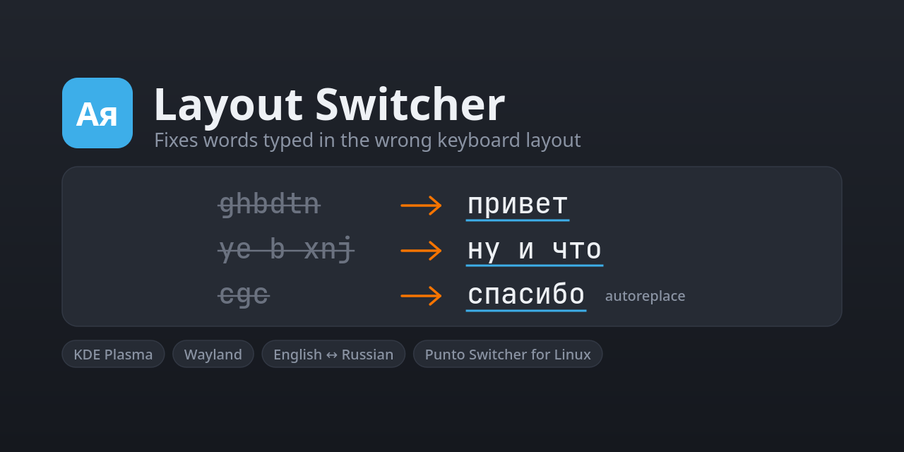

# Layout Switcher



Fixes words typed in the wrong keyboard layout (English ↔ Russian, English ↔ Ukrainian) on KDE Plasma under Wayland. It works like Punto Switcher.

Type `ghbdtn` and press Space: the word is erased and retyped as `привет`, and the keyboard switches to the Russian layout. It works in every application: terminals, browsers, messengers, editors.

## Features

- **Automatic layout fixing.** When a word ends with a space, the program checks whether it reads better in the other layout. If it does, it retypes the word and switches the layout. Capital letters and trailing punctuation are preserved: `Ghbdtn?` becomes `Привет,`.
- **Ukrainian too.** With the `ua` layout in KDE and the Ukrainian aspell dictionary installed, `ghbdsn` becomes `привіт`. For a word typed in Latin letters, both the Russian and the Ukrainian reading are checked, and the one that is a word wins. When both are words (`vfvf` → `мама`), the Cyrillic layout you typed in last wins.
- **Context for short words.** Short words right before a fixed word are fixed together with it if they are words in the other layout too. `ye b xnj` becomes `ну и что`, even though `ye` is an English word and `b` is a single letter.
- **Manual conversion with double Shift.** Tap Shift twice to retype the current word, or the one you just finished, in the other layout.
- **Undo that learns.** If a word was fixed by mistake, tap Shift twice right away. The word comes back, and the program remembers it and never fixes it again.
- **Autoreplace.** Your own abbreviations: `thx` → `thanks`, `email` → `name@example.com`. An abbreviation typed in the wrong layout also works.
- **Tray icon.** It flashes on every fix or expansion and turns grey while paused. A left click pauses or resumes. The menu toggles fixing, start at login and the autoreplace list.

## Requirements

- KDE Plasma 6 on Wayland. The layout is read and switched over KDE's D-Bus interface `org.kde.keyboard`.
- The `us` layout and at least one of `ru` and `ua` configured in KDE. Other layouts are left alone.
- Python 3.11 or newer, plus:
  - `aspell` with the English and Russian dictionaries, plus the Ukrainian one for Ukrainian;
  - `busctl`, which ships with systemd;
  - PyQt6 for the tray icon. pipx installs it for you; for a clone, install it from your distribution.

  On Debian or Ubuntu:

  ```sh
  sudo apt install aspell aspell-en aspell-ru aspell-uk python3-pyqt6 pipx
  ```

- Your user in the `input` group, so that the program can read the keyboard and create a virtual one:

  ```sh
  sudo usermod -aG input $USER   # then log out and back in
  ```

Everything else is the Python standard library.

## Installation

### With pipx

```sh
pipx install git+https://github.com/Charly3X/layout-switcher
layout-switcher
```

The icon appears in the system tray. To start it automatically, tick **Start at login** in the tray menu. This creates `~/.config/autostart/layout-switcher.desktop`, which KDE's Autostart settings also show.

To update: `pipx upgrade layout-switcher`. To remove: `pipx uninstall layout-switcher`.

### From a clone

```sh
git clone https://github.com/Charly3X/layout-switcher.git
cd layout-switcher
./install.sh
```

`install.sh` adds "Layout Switcher" to the application menu and starts it in the tray. Start at login works the same way.

### First start

The first start takes about 10 seconds: a letter model is built from the aspell dictionaries and cached in `~/.cache/layout_switcher/`.

Only one copy runs at a time. Quit the running one before starting another.

## Running by hand

```sh
layout-switcher            # tray icon
layout-switcher --no-tray  # no icon, for a plain terminal or a service
layout-switcher --debug    # log every fix, including the words
layout-switcher --check ghbdtn hello j,tl   # only print the decisions
```

From a clone without pipx, use `python3 -m layout_switcher` instead of `layout-switcher`.

To pause or resume from a script or a global shortcut:

```sh
pkill -USR1 -f layout_switcher
```

## Configuration

### Autoreplace

Choose **Edit autoreplace list…** in the tray menu. This opens `~/.config/layout_switcher/autoreplace.txt` and creates it on first use. Write one entry per line:

```
thx = thanks
спс = спасибо
email = name@example.com
т.е. = то есть
```

- An entry expands when you type a space after it. Surrounding punctuation stays: `thx!` → `thanks!`.
- The case follows the abbreviation: `Thx` → `Thanks`, `THX` → `THANKS`.
- An abbreviation typed in the wrong layout expands too: `cgc` → `спасибо`, and the keyboard switches to Russian. This does not happen when what you typed is a real word in the current layout.
- A replacement can mix Russian, Ukrainian, English, digits and punctuation. The program switches layouts as it types and returns to the abbreviation's layout at the end.
- Double Shift right after an expansion brings the abbreviation back.
- Changes apply immediately; no restart is needed.
- Replacements are single-line. Characters that neither layout has (`ł`, `€`) are not supported: such an entry is skipped with a warning in the log.

### Exceptions

Words you turned back with double Shift are stored in `~/.config/layout_switcher/exceptions.txt`, one `layout:word` per line, for example `us:ghbdtn`. Edit or delete lines to change them; the file is read at startup.

### Tuning

The decision thresholds live in `layout_switcher/language.py` (`Judge.SCORE_MARGIN`, `Judge.PLAUSIBLE_SCORE`). `python3 tools/evaluate.py` measures how often the letter model alone would make a wrong switch or miss one at different margins.

## How it works

1. It reads key events straight from `/dev/input/event*`. It remembers key codes rather than letters, so the same word can be read in both layouts.
2. When a word ends, it decides in this order:
   - a word found in the current layout's aspell dictionary is left alone;
   - a word found in the other layout's dictionary is fixed. For words shorter than four letters, the letter statistics must agree as well, so that `ок` does not turn into `jr`;
   - otherwise, letter-trigram statistics of both layouts are compared, and the word is fixed only by a wide margin.
3. To fix a word, it switches the layout over D-Bus first, so that a failure deletes nothing. It then sends Backspaces and the same keys again through its own `uinput` virtual keyboard.
4. Mouse clicks, arrows, Enter, Tab and Ctrl/Alt/Meta shortcuts reset the current word. After Enter it is too late anyway, since a message may already be sent. A word left alone for 30 seconds is forgotten too.
5. On the lock screen, and while another user's session is in front, keys are neither kept nor acted on. Before every fix, expansion or double Shift, the program asks logind whether the session in front on `seat0` (the one the physical keyboard types into) is yours and unlocked, and asks the KDE screen locker. If either answer is unclear, it does nothing.

## Limitations

- The program sees every key press, passwords included. It sends nothing anywhere and stores only the exceptions and autoreplace files (both readable by you only). The lock screen is covered (see above), but Wayland gives no way to detect a password field inside an application, so pause the program before typing a password there.
- If you keep typing straight after the space, the word is not fixed, so that your keys and the program's keys do not interleave. Fix such a word with double Shift. Typing during the fraction of a second that a retype takes can still mix the text.
- Short words that exist in both dictionaries (`ye`/`ну`, `vs`/`мы`) are fixed only together with the following word. At the end of a phrase, use double Shift.
- Only the `us`, `ru` and `ua` layouts are supported. A Ukrainian word typed in the Russian layout, or the other way round, is not fixed.

## Development

```sh
python3 -m unittest discover -s tests -t .
```

The tests use fake keyboards and layouts. They never touch real input devices.

## License

MIT. See [LICENSE](LICENSE).
